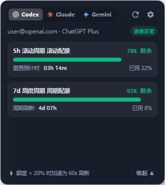

# AI Quota Bar (AI 任务栏多模型实时配额监控器)

<p align="center">
  <b>专为 Windows 打造的极轻量、高性能 AI 配额实时监控胶囊微件</b><br>
  <i>完美贴合 Windows 11/10 任务栏系统托盘，实时监控 OpenAI Codex、Google Gemini / Antigravity、Anthropic Claude 配额。</i>
</p>

---

## 🖼️ 软件界面预览

<div align="center">

### 1. 任务栏微型双行胶囊（与 Windows 11 托盘时钟高度对齐）
<p align="center">
  
</p>

### 2. 多维详情面板与 Fluent 暗色设置中心
<table align="center">
  <tr>
    <td align="center" valign="top" width="40%">
      <b>📊 配额详情浮窗 (Flyout)</b><br/>
      <sub>支持多模型Tab切换、官方矢量图标、临界高精动态倒计时</sub><br/><br/>
      
    </td>
    <td align="center" valign="top" width="60%">
      <b>⚙️ Fluent 独立暗色设置中心 (Settings)</b><br/>
      <sub>统一无边框暗黑设计、频率阈值定制、Fluent下拉框与自启动</sub><br/><br/>
      
    </td>
  </tr>
</table>

</div>

---

## 🌟 核心特性

- **任务栏同列双行极窄胶囊（~95px 宽度）**
  - 与 Windows 11 原生任务栏时间区域（上行时间、下行日期）视觉高度协同。
  - **上行**：展示 5h / 短期滚动配额（微型彩色进度条 + 剩余百分比）。
  - **下行**：展示 7d / 周度周期配额（微型彩色进度条 + 剩余百分比）。
- **多模型平台支持与官方矢量图标**
  - **OpenAI Codex**：自动解析 `~/.codex/credentials.json`，支持 5h 与 7d 限额跟踪与限流自愈。
  - **Google Gemini (Antigravity)**：本地进程与端口自动探测，直连 Antigravity 本地语言服务 RPC 接口，实时获取真实账户模型额度及重置时间戳。
  - **Anthropic Claude Code**：内置官方品牌矢量微标与模块化提供商接口。
  - **无缝滚轮切换**：鼠标停留在胶囊上滚动滚轮即可毫秒级切换不同 AI 平台。
- **高精动态倒计时系统**
  - **长周期（> 1 小时）**：低频节能刷新，显示精简时间（如 `3h 40m`）。
  - **临界周期（< 1 小时）**：**全自动切换为每秒高精刷新**（如 `45m 12s`），配额重置时刻了然于胸。
- **健康度三色分级与智能阶梯自适应调度**
  - 🟢 **充裕安全（≥ 50%）**：翡翠绿 (`#10B981`)，安心编程。
  - 🟡 **注意分配（20% ~ 50%）**：琥珀黄 (`#F59E0B`)。
  - 🔴 **额度告警（< 20%）**：珊瑚红 (`#EF4444`)，自动触发加速轮询。
  - 🛡 **智能限流避让**：遇到 HTTP 429 时，智能识别 `Retry-After` 头并启动冷却计时，避免频繁请求触发惩罚。
- **极致的轻量与低资源消耗**
  - 采用 WPF `SoftwareOnly` 软解管线渲染，彻底杜绝独立显卡显存浪费。
  - 内置工作集内存自动修整机制（Working Set Trim），空闲常驻内存仅 **~3MB**。
  - 单文件绿色发布，可执行程序体积仅 **610 KB**。
- **Windows 11 Fluent 独立暗色设置中心**
  - 原生无边框标题栏与窗口控制按钮，深度整合 Windows 11 暗色主题。
  - 自定义 Fluent 风格下拉框与开关组件，支持配置常规刷新周期、低额度加速阈值、色彩分界线、平台开关及开机自启动。
- **沉浸式半透明详情弹窗（Flyout）**
  - 左键单击胶囊即可呼出，直观展示各模型的详细剩余百分比、配额状态及精确重置倒计时。

---

## 📸 交互指南

| 交互方式 | 行为说明 |
| :--- | :--- |
| **鼠标左键单击胶囊** | 呼出 / 隐藏多维配额详情弹窗（半透明 Fluent 浮窗） |
| **鼠标滚轮滚动** | 在已启用的 AI 平台（Codex / Gemini / Claude）之间循环切换 |
| **鼠标右键单击胶囊** | 呼出快捷上下文菜单（立即刷新数据、打开设置中心、退出程序） |

---

## 📁 目录结构

```text
AIQuotaBar/
├── src/
│   ├── AIQuotaBar.Core/          # 核心业务逻辑库（跨平台通用）
│   │   ├── Models/               # 数据模型（配额快照、健康等级、设置模型）
│   │   ├── Providers/            # AI 提供商实现（Codex、Gemini、Claude）
│   │   └── Services/             # 凭证探测器、智能调度引擎、配置管理服务
│   ├── AIQuotaBar.App/           # 宿主与 UI 表现层（WPF + Win32）
│   │   ├── Windows/              # 任务栏胶囊窗体、详情浮窗、Fluent 设置中心
│   │   ├── Controls/             # 自定义矢量图标、微型双进度条
│   │   └── Native/               # Win32 任务栏嵌入、窗口定位、内存修整 API
│   └── AIQuotaBar.Tests/         # 自动化测试工程（28 项单元测试覆盖）
├── dist/                         # 预编译绿色可执行程序（AIQuotaBar.exe）
├── AIQuotaBar.slnx               # Visual Studio 解决方案文件
└── README.md                     # 项目中文文档
```

---

## 🛠 编译与开发

### 环境要求

- **操作系统**：Windows 10 1809 (Build 17763) 或更高版本 / Windows 11
- **开发工具链**：.NET 10.0 SDK

### 1. 编译项目
```powershell
# 克隆或进入项目根目录
cd E:\MyDevelopment\AIQuotaBar

# 恢复依赖并编译
dotnet build
```

### 2. 运行自动化单元测试
项目包含 28 个针对调度器阶梯频率、限流退避、配额状态计算及提供商解析的单元测试：
```powershell
dotnet test
```

### 3. 本地启动调试
```powershell
dotnet run --project src/AIQuotaBar.App/AIQuotaBar.App.csproj
```

---

## 📦 打包与单文件发布

本项目支持快速打包为便携、无依赖冗余的单文件可执行程序：

```powershell
dotnet publish src/AIQuotaBar.App/AIQuotaBar.App.csproj `
  -c Release `
  -r win-x64 `
  -p:PublishSingleFile=true `
  -p:SelfContained=false `
  -p:EnableCompressionInSingleFile=true `
  -o dist
```

> **说明**：生成的 `dist/AIQuotaBar.exe` 仅约 610 KB，需目标机器已安装 [.NET 10 Desktop Runtime](https://dotnet.microsoft.com/download/dotnet/10.0)。双击即可静默吸附于 Windows 任务栏通知区左侧。

---

## 💡 致谢与灵感

- 感谢 [upstream-ray/codex-usage-monitor](https://github.com/upstream-ray/codex-usage-monitor) 带来的灵感与核心任务栏吸附理念。
- 本项目在此基础上升级为多平台聚合监控、极简软解内存优化与更贴近 Windows 11 Fluent 语言的现代化微件。

---

## 📄 开源许可证

本项目遵循 [MIT License](LICENSE) 开源协议。
